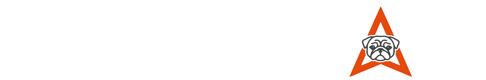
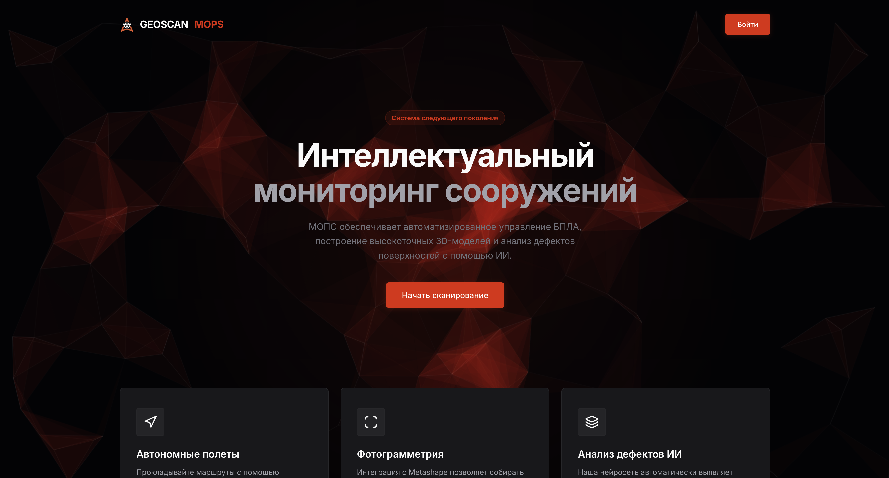
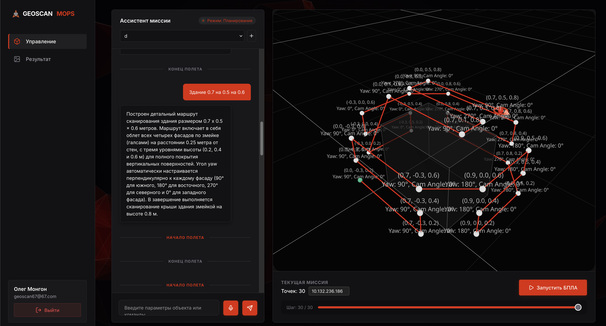
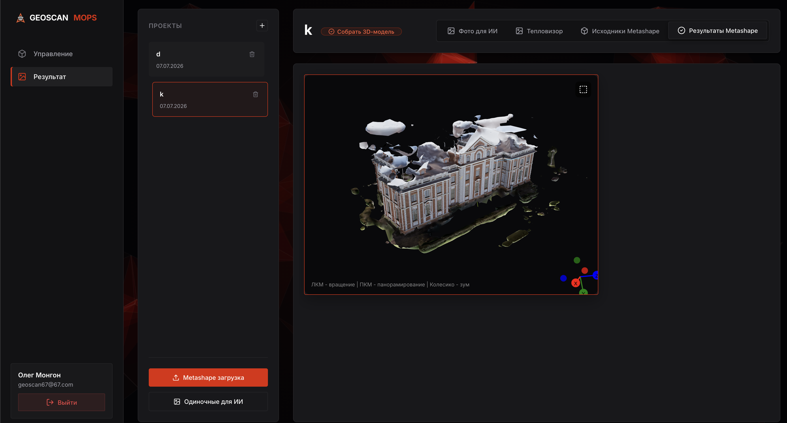
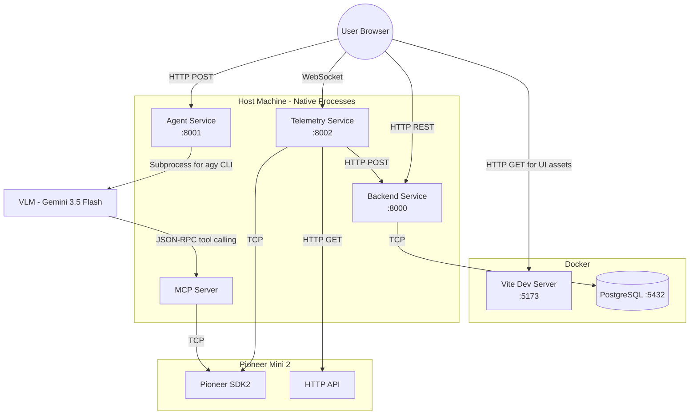
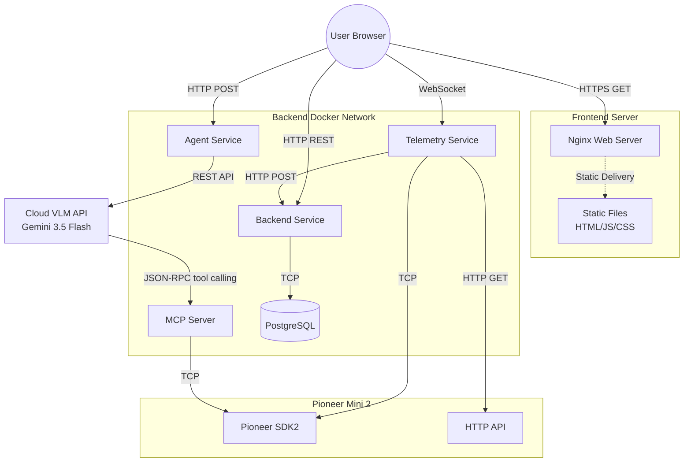

<div align="center">
  
  <h1>MOPS: Monitoring and Inspection of Structure Surfaces</h1>
  <p>
    <em>Automated building facade inspection system using unmanned aerial vehicles, photogrammetry, and AI.</em>
  </p>
  <p>
    <a href="#architecture">Architecture</a> •
    <a href="#computer-vision-modules-ai">Computer Vision</a> •
    <a href="#how-it-works">How It Works</a> •
    <a href="#deployment-production-vs-development">Deployment</a> •
    <a href="README_RU.md">Русская версия</a>
  </p>
</div>

---

## About the Project

**MOPS** is a hardware-software platform developed with support from **Geoscan**. The system automates the inspection of building facades and large-scale infrastructure, detecting surface defects (cracks, structural damage) using autonomous drones.

Operators can assign tasks using natural language. An intelligent agent (LLM) formulates the flight mission, while the drone (**Pioneer Mini 2**) conducts autonomous flight and image acquisition. The backend reconstructs captured photographs into a planar facade orthomosaic (via Agisoft Metashape) and localizes damage using a neural network ensemble (YOLOv8 and Crack-SAM).

---

## Key Features

- **LLM-Driven Mission Planning:** Translates text or voice instructions into low-level flight commands via the Model Context Protocol (MCP).
- **High-Precision Photogrammetry:** Generates facade orthomosaics and Digital Elevation Models (DEM) to eliminate optical perspective distortions.
- **Neural Network Ensemble for Defect Detection:** Combines a fast YOLOv8 detector with a high-precision Crack-SAM model for fine crack segmentation.
- **Real-Time Telemetry:** Streams drone coordinates and video to the operator web interface over WebSockets with minimal latency.
- **Microservice Architecture:** Modular system components isolated in Docker containers via Docker Compose.

---

## Web Interface Screenshots

Key interface screens of the system:

<div align="center">
  
  <br><em>Main home dashboard</em><br><br>
  
  
  <br><em>Flight planning and execution dashboard</em><br><br>
  
  
  <br><em>Inspection results (3D building model with detected defects)</em><br><br>
</div>

---

## Architecture

Due to staged project development and third-party license constraints (Agisoft Metashape), the system supports two operational configurations: **Production** and **Development**. Both follow a microservice pattern to decouple heavy computation from real-time telemetry streaming.

### 1. Development Architecture (Local)

Launched via `start.sh`. Backend services run as native host processes (providing direct access to hardware-bound Metashape licenses), while the Database and Frontend run inside Docker.



### 2. Target Architecture (Production)

Final deployment architecture. All server components run inside Docker containers, and the Frontend is compiled into static assets served via a web server.



### Core System Components:
1. **Frontend**: React SPA application (built with Vite). Rendered client-side and served via Nginx.
2. **Backend**: Central API built with FastAPI. Manages projects, sessions, and triggers photogrammetry and anomaly detection pipelines.
3. **Agent Service**: Planning module. Translates operator intent into structured inputs for the Vision-Language Model (VLM).
4. **MCP Server**: Model Context Protocol server. Bridges the VLM and the drone SDK, converting tool calls into flight commands (takeoff, coordinate navigation).
5. **Telemetry Service**: Telemetry collection service. Streams real-time drone telemetry to the Frontend and forwards captured frames to the Backend.
6. **Database**: PostgreSQL.

---

## Computer Vision Modules (AI)

Two neural network architectures are employed to balance inference speed with segmentation precision when inspecting facade orthomosaics.

### 1. Yolo26m
A fast model for segmenting facade cracks and vegetation overgrowth. Trained on a specialized dataset.
- **Dataset:** 8,820 images.
- **Metrics:**
  - Mask Precision: 72.5%
  - Recall: 64.7%
  - mAP50: 69.2%
  - mAP50-95: 42.8%

### 2. Crack-SAM (Segment Anything Model)
A fine-tuned adapter based on Meta's SAM (ViT-H) foundation model, designed for high-precision segmentation of complex crack geometries.
- **Dataset:** Open-source crack inspection dataset.

### Weights Placement
Model weight files must be placed in the `weights` directory in the backend root:
- `backend/weights/yolo/best.pt` (configurable via `YOLO_MODEL_PATH`).
- `backend/weights/cracksam/CrackSAM_adapter_d32.pth`
- `backend/weights/cracksam/sam_vit_h_4b8939.pth`

---

## How It Works

1. **Mission Initialization:** The operator submits a natural language request. `Agent Service` forwards it to the VLM.
2. **Autonomous Flight:** The VLM invokes flight commands through `Pioneer MCP`. The drone performs the flight path. `Telemetry Service` broadcasts coordinates to the UI and routes photos to `Backend`.
3. **Photogrammetry:** `Backend` triggers Agisoft Metashape for camera alignment, dense point cloud generation, and facade orthomosaic export.
4. **Defect Detection:** The orthomosaic is sliced into tiles (preserving resolution) and processed through YOLOv8 or Crack-SAM.
5. **Aggregation (NMS):** Tile detections are merged using Non-Maximum Suppression to eliminate duplicate bounding boxes, and the final results are served to the client.

---

## Deployment (Production vs Development)

The platform supports two deployment workflows: **Production** and **Development**.

### 1. Production Environment

Production uses strict microservice isolation:
- **Backend Infrastructure:** All services (`backend`, `ai_service`, `telemetry_service`, `pioneer_mcp`, and `PostgreSQL`) run in isolated Docker containers using the provided Dockerfiles.
- **Frontend:** Compiled into static assets (`npm run build`) and served via a high-performance web server (e.g., Nginx) to optimize memory usage and load times.

*(Note: Work is ongoing to containerize hardware-locked Agisoft Metashape licenses).*

### 2. Local Development (`start.sh`)

The `start.sh` script orchestrates the mixed development environment, bypassing host-specific Metashape licensing restrictions:
1. Starts **PostgreSQL** and the **Frontend (dev mode)** inside Docker (`docker-compose up -d`).
2. Synchronizes and installs all Python dependencies with **uv** (`uv sync`).
3. Launches all backend microservices (`backend`, `ai_service`, `telemetry_service`, `pioneer_mcp`) **natively on the host machine** as background processes.
4. Handles graceful shutdown of processes and containers when exiting.

**Starting Development:**
```bash
git clone https://github.com/ArduRadioKot/Geoscan_MOPS.git
cd Geoscan_MOPS
chmod +x start.sh
./start.sh
```
The web interface will be available at `http://localhost:5173`.

---

## Tech Stack

- **Frontend:** React 19, Vite, Styled Components.
- **Backend:** FastAPI, PostgreSQL, Uvicorn, Python 3.12+.
- **Computer Vision:** YOLOv8 (Ultralytics), Segment Anything (SAM), OpenCV, Agisoft Metashape Python API, SAHI.
- **LLM Infrastructure:** Model Context Protocol (MCP), FastMCP, Gemini 3.5 Flash.
- **Hardware:** Pioneer SDK2 (TCP/HTTP API), Pioneer Mini 2.

---

Project developed with support from **Geoscan**.
